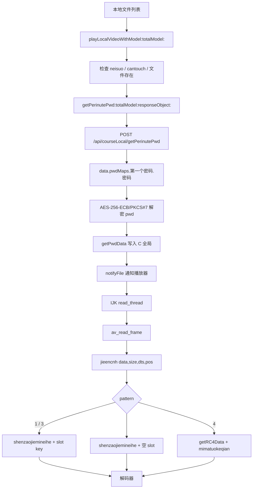

# SzPlayer 26.10.56 离线播放与视频解密分析

本文分析 SzPlayer 在 macOS 上的离线播放、视频 sample 解密和密码字段处理。分析对象为 `SzPlayer.app/Contents/MacOS/SzPlayer`，主要使用 REA 6.8.0 做样本盘点和函数定位，使用 IDA Pro 9.4 做 arm64 反编译与交叉引用分析。

| 项目 | 值 |
|---|---|
| 样本 | `SzPlayer.app` |
| Bundle ID | `ZZZDispatch.szPlayer-Mac` |
| 版本 | `26.10.56` |
| Build | `26.10.56` |
| 最低系统 | macOS 11.0 |
| 分析对象 | `SzPlayer.app/Contents/MacOS/SzPlayer` |
| 架构 | universal，x86_64 + arm64 |
| 主要分析切片 | `analysis/SzPlayer_arm64`（arm64） |

哈希：

```text
universal SHA256:
801f49182b6b1f6c1d64d838feea1fcd207631a3561c27ef581599573facc743

arm64 slice SHA256:
865d4f6cb7dc239744ab7f7d8fe412de22d8a1aceac7a3b28da333e07c86eab3
```

分析方式：

- 使用 REA 6.8.0 盘点样本、定位函数和整理调用关系。
- 使用 IDA Pro 9.4 对 arm64 切片做反编译和交叉引用。
- 使用本机 CommonCrypto 小程序与 OpenSSL 对照验证 AES 参数。
- 使用合成 MP4 验证 RC4 派生和 sample 解密流程。
- 使用 `analysis/sz_decrypt.py` 和 `analysis/sz_key_unwrap.py` 复现关键算法。

## 阅读说明与证据状态

本文内容按证据状态分为三类：

| 状态 | 含义 | 本文涉及内容 |
|---|---|---|
| 已验证 | 已通过二进制、代码或自测确认 | 函数地址、AES 参数、`softMd5`、RC4 往返测试、参考工具自测 |
| 静态推断 | 由调用点和 FFmpeg 行为推导，尚未用真实样本验证 | `.sz` 容器结构、sample 与 packet 的一一对应关系 |
| 待确认 | 需要真实会话或真实文件补充验证 | 真实 `pattern`、`den1`、`pmn`、slot key、`pwd_Audio` 变换 |

工作区中没有实际的 `.sz` 视频样本。因此，容器结构部分是根据调用点和 FFmpeg 行为做出的静态推断，文中会明确标注。

阅读顺序建议：

1. 阅读第 1 至第 4 节，了解离线播放的实际行为和运行所需状态。
2. 阅读第 5 至第 7 节，了解请求签名、AES 解密和视频 packet 解密算法。
3. 阅读第 8 至第 9 节，使用参考工具并做动态验证。
4. 第 10 至第 15 节提供 PDF 附录、地址索引、复现步骤和限制说明。

---

## 1. 结论

| 序号 | 结论 | 证据状态 |
|---:|---|---|
| 1 | 离线播放仍要请求服务端。`LocalFileViewController` 在播放本地 `.sz` 前调用 `POST /api/courseLocal/getPerinutePwd` 获取 `pwdMaps`，本地文件内没有可直接使用的主密钥。 | 已验证 |
| 2 | 下载与解密分离。下载工具把服务端返回的密文原样写入本地目录，下载阶段不做解密。 | 已验证 |
| 3 | 视频层是逐 packet 的自定义 RC4。IJK 的 `read_thread` 在 `av_read_frame` 成功后、入队解码前调用 `jieencnh()`，原地修改 `AVPacket.data`。 | 已验证 |
| 4 | slot 由文件偏移决定，不是 DTS。`jieencnh()` 的第四个参数是 `AVPacket.pos`，slot 公式使用 `pos`；`dts` 字段在 API 中实际也是按 slot 反推出来的字节偏移。 | 已验证 |
| 5 | 密码字段不是 AES-CBC-128。`LocalFileViewController aesDecryption:encKey:` 走 `NSData+CustomPadding`，CommonCrypto 的 `mode=1` 是 ECB，密钥长度为 32 字节，实际算法为 AES-256-ECB/PKCS#7。`cfg.ini` 中的 `AES_CBC_128` 不属于这条路径。 | 已验证 |
| 6 | 密钥派生链是两层。服务端先用 `MD5(softMd5 + md51 + md52 + md53)` 作为 AES key 加密 `pwdMaps`；客户端解出 `pwd` 后，再把 `pwd`、`pattern`、`pmn`、`whenLong` 写入 C 全局，供 `jieencnh()` 派生每个 packet 的 RC4 key。 | 已验证 |
| 7 | 没有本地密钥缓存。`playLocalVideoWithModel:`、`playhistory:` 和在线播放都走 `getPwdData()`；本地数据库和下载目录没有发现 `pwdMaps` 或 slot key 的持久化。 | 已验证 |
| 8 | PDF 使用独立格式。`.szpdf` 使用 `SZPDF` 头、SHA-256 KDF 和 AES-256-CBC/PKCS#7，与视频 RC4 无关。 | 已验证 |

## 2. 总体流程



## 3. 下载与本地文件布局

### 3.1 路径构造

相关函数：

| 函数 | 地址 |
|---|---:|
| `+[Tool getAppDirectory]` | `0x100106e38` |
| `+[Tool getUserDirectory]` | `0x100106f5c` |
| `+[Tool getVideoFileDirectory]` | `0x100107324` |
| `-[HQSingleton preparedLocalFileURLForModel:removeExisting:]` | `0x100094f68` |
| `-[HQSingleton startDownLoadWithListModel:progress:success:failure:]` | `0x100095448` |
| `-[QDNetServerDownLoadTool AFDownLoadFileWithUrl:progress:fileLocalUrl:success:failure:]` | `0x10006d130` |

路径拼接结果：

```text
NSDocumentDirectory
  └── sz
      └── <loginName>
          └── videoFile
              └── <sectionName>
                  └── <courseName>.<encryptionType>
```

`preparedLocalFileURLForModel:removeExisting:` 的逻辑：

```objc
NSString *name = [NSString stringWithFormat:@"%@.%@",
                  model.courseName ?: @"",
                  model.encryptionType ?: @"sz"];
NSString *dir = [Tool getVideoFileDirectory];
NSString *sectionDir = [dir stringByAppendingPathComponent:model.sectionName ?: @""];
[[NSFileManager defaultManager] createDirectoryAtPath:sectionDir
                          withIntermediateDirectories:YES
                                           attributes:nil
                                                error:nil];
NSString *path = [sectionDir stringByAppendingPathComponent:name];
return [NSURL fileURLWithPath:path];
```

典型结果：

```text
~/Documents/sz/<loginName>/videoFile/<sectionName>/<courseName>.sz
```

`encryptionType` 为空时默认使用 `sz`。代码不会自动追加 `.mp4`。

### 3.2 下载阶段不解密

`AFDownLoadFileWithUrl:...` 使用 `AFURLSessionManager` 的 download task，`destination` 直接指向 `fileLocalUrl`。下载完成后，文件仍是服务端返回的密文。解密发生在播放阶段，由 FFmpeg 的 packet 层完成。

### 3.3 本地列表

`-[LocalFileViewController saveLsitWithComplete:failure:]`（`0x10007c428`）保存本地列表，包含 `locaPathString`、`enc_md5Str` 等字段。没有发现保存 `pwdMaps`、`quanju_mima` 或 slot key 的代码。

## 4. 离线播放调用关系

### 4.1 `playLocalVideoWithModel:totalModel:`

地址：`0x1000776d4`

主要步骤：

1. 读取 `RequstManager.neisuo`。值为 `1` 时，提示「您的上一次验证码没通过，请重新登录！」并返回。
2. 检查 `_cantouch` 和 `RequstManager.fangzhipinfan`，防止重复点击。
3. 检查 `model.locaPathString` 是否存在。文件不存在时，提示「视频不存在！」。
4. 文件存在时，执行以下操作：
   - 调用 `setClickIntger:1`。
   - 调用 `[HQSingleton startLoading]`。
   - 调用 `getPerinutePwd:totalModel:responseObject:`。
5. 密码请求成功后，进入 block `0x100078048`：
   - 读取 `response.data.pwdMaps["第一个密码"]["密码"]`。
   - 计算 `aesKey`。
   - 调用 `aesDecryption:encKey:` 解出 `pwd`。
   - 调用 `getPwdData(...)`。
   - 调用 `getPlayerPath:andTotalModel:` 获取本地路径。
   - 发送 `notifyFile` 通知，携带 `filepath`、`sectionName`、`name`。
   - 初始化 PDF 课件窗口。

关键行为：播放本地文件前一定会发送密钥请求，没有「文件已下载就直接播放」的分支。

### 4.2 `getPerinutePwd:totalModel:responseObject:`

地址：`0x10007b014`

请求 block：`0x10007b29c`

响应 block：`0x10007bff8`

请求前处理：

```objc
NSData *fileData = [self fileSystemRepresentationWithPath:model.locaPathString];
self.enc_md5Str = [fileData JZMD5];
NSString *uit = [RequstManager.sharedInstance refreshUit2BeforeRequest];
if (uit.length <= 0x5A) {
    // 「UIT异常，请重新登陆」
}
```

请求体：

```json
{
  "startTime": "1",
  "endTime": "1",
  "encryptionMd5": "<AES(file_md5)>",
  "userId": "<AES-decrypt(userId)>",
  "softMd5": "<AES(soft_md5)>"
}
```

字段名在 `__DATA_CONST,__cfstring` 中确认：

```text
startTime
endTime
encryptionMd5
userId
softMd5
```

接口：

```text
POST /api/courseLocal/getPerinutePwd
```

响应中使用的字段：

```text
data.pwdMaps.第一个密码.密码
data.pattern
data.pmn
data.whenLong
data.pwd_Audio
data.Audio_start
```

响应 block 还会把本次请求的 `md51Str2`、`md52Str2`、`md53Str2` 写入响应字典：

```objc
[dict setObject:a1[4] forKeyedSubscript:@"__uit2_md51"];
[dict setObject:a1[5] forKeyedSubscript:@"__uit2_md52"];
[dict setObject:a1[6] forKeyedSubscript:@"__uit2_md53"];
```

后续播放 block 优先读取响应中的 `__uit2_md5x`。读取不到时，才读取 `RequstManager` 的当前值。

### 4.3 `fileSystemRepresentationWithPath:` 的实际行为

地址：`0x100080be8`

方法名容易误解。实际逻辑如下：

```objc
if (![[NSFileManager defaultManager] fileExistsAtPath:path]) return nil;
NSDictionary *attrs = [[NSFileManager defaultManager] attributesOfItemAtPath:path error:nil];
unsigned long long size = [attrs fileSize];
if (size <= 100 * 1024 * 1024) {
    data = [NSData dataWithContentsOfFile:path];
} else {
    NSFileHandle *fh = [NSFileHandle fileHandleForReadingAtPath:path];
    data = [fh readDataOfLength:100 * 1024 * 1024];
}
return data;
```

由此可以确认：

- `enc_md5Str` 是文件内容 MD5，不是路径字符串 MD5。
- 文件大于 100 MiB 时，只取前 100 MiB 计算 MD5。这是样本的固定行为。
- `JZMD5` 输出 32 字符小写十六进制。

### 4.4 `playhistory:` 同样要获取密钥

`-[LocalFileViewController playhistory:]`（`0x100072dd8`）最终也调用 `getPerinutePwd:totalModel:responseObject:`，然后走同一个 `getPwdData` 和 `notifyFile`。历史记录播放不是本地密钥回放。

### 4.5 仅依赖 `.sz` 文件的限制

播放流程需要以下运行时状态：

```text
pwd        = 服务端 pwdMaps 解出的主密钥
pattern    = data.pattern
pmn        = data.pmn
whenLong       = data.whenLong
slot keys  = 播放过程中按需从 getPwd3V2 获取
```

这些值都不在 `.sz` 文件里。缺少这些值时，`jieencnh()` 无法还原 RC4 key。

---

## 5. 请求签名与 UTI

### 5.1 `refreshUit2BeforeRequest`

地址：`0x100085d58`

```objc
- (NSString *)refreshUit2BeforeRequest {
    return [self generateUitHeaderWithIndependentSlot:YES];
}
```

### 5.2 `generateUitHeaderWithIndependentSlot:`

地址：`0x100085828`

函数先生成三个随机串：

```text
%u|%@|%llu|%llu|%llu|%u
```

参数依次为：

```text
arc4random()
uitTokenSeed
currentMicroTimestamp
atomic sequence
pthread_mach_thread_np(pthread_self())
arc4random()
```

三个串分别做 MD5，得到 `md51`、`md52`、`md53`，然后调用 `jiamixieyiWithMD51:MD52:MD53:`。

### 5.3 `jiamixieyi` 的打包格式

`0x10015d798` 使用以下格式串：

```c
"%.4s%.4s%.11s%.16s%.12s%.9s%.16s%.16s%.12s%.4s"
```

拼接顺序：

```text
md5(t1)[3:7]
md51[0:4]
md52[9:20]
md53[0:16]
md51[4:16]
md52[0:9]
md53[16:32]
md51[16:32]
md52[20:32]
md5(t2)[0:4]
```

结果为 104 字符。随后执行一次插入：

```c
"%.5ss%.3sz%.2sk%.2sj%s"
```

插入规则：

```text
base[0:5]   + "s" +
base[5:8]   + "z" +
base[8:10]  + "k" +
base[10:12] + "j" +
base[12:]
```

插入后得到 108 字符的 `uit`。

`getPwd3V2` 使用的 C 版本 `sz_build_stable_uit_for_pwd`（`0x10015e864`）还会在末尾追加 `huoqushijianchuocha()` 的结果。该结果是「当前毫秒时间戳减去起始时间戳」的十进制后三位，长度为 0 至 3 位。

服务端从 `uit` 中还原 `md51`、`md52`、`md53`，再用它们和 `softMd5` 派生 `pwdMaps` 的 AES key。响应按本次请求的 UTI 加密密码字段。

## 6. 密码字段的 AES 解密

### 6.1 调用关系

```objc
// playLocalVideoWithModel 的响应 block
NSString *pwdCipher = response[@"data"][@"pwdMaps"][@"第一个密码"][@"密码"];

NSString *md51 = response[@"__uit2_md51"] ?: [RequstManager sharedInstance].md51Str2;
NSString *md52 = response[@"__uit2_md52"] ?: [RequstManager sharedInstance].md52Str2;
NSString *md53 = response[@"__uit2_md53"] ?: [RequstManager sharedInstance].md53Str2;
NSString *soft = [RequstManager sharedInstance].md5;

NSString *base = [NSString stringWithFormat:@"%@%@%@%@", soft, md51, md52, md53];
NSString *aesKey = [base JZMD5];  // 32 字符小写十六进制
NSString *pwd = [self aesDecryption:pwdCipher encKey:aesKey];
```

### 6.2 AES key 使用 32 字符 ASCII 串

`aesKey` 是 32 个 ASCII 字符，例如：

```text
0123456789abcdef0123456789abcdef
```

进入 `SettingKeyLengths_0` 后，长度按以下规则处理：

```c
case 0:  // kCCAlgorithmAES
    if (key.length <= 16)      key.length = 16;
    else if (key.length <= 24) key.length = 24;
    else                       key.length = 32;
```

32 字符对应 32 字节，因此算法为 AES-256。将 `aesKey` 按十六进制解码成 16 字节会导致解密失败。

### 6.3 实际 AES 参数

`-[LocalFileViewController aesDecryption:encKey:]`（`0x10007a618`）：

```objc
NSData *data = [[NSData alloc] initWithBase64EncodedString:input options:1];
NSData *plain = [data cc_decryptUsingAlgorithm:0
                                           key:encKey
                          InitializationVector:@""
                                          Mode:1
                                       Padding:1];
return [[NSString alloc] initWithData:plain encoding:NSUTF8StringEncoding];
```

`cc_decryptUsingAlgorithm:key:InitializationVector:Mode:Padding:`（`0x10015c644`）把参数传给 `cc_cryptologyUsingOperation:Algorithm:Padding:Mode:key:initializationVector:error:`（`0x10015c754`）。后者调用：

```c
CCCryptorCreateWithMode(
    kCCDecrypt,      // op = 1
    mode,            // 1
    kCCAlgorithmAES, // alg = 0
    ccPKCS7Padding,  // padding = 1
    iv,              // 指向零填充缓冲区；ECB 不读取
    key,             // 32 字节 ASCII
    32,              // keyLength
    NULL, 0, 0,
    2,               // kCCOptionECBMode
    &cryptorRef);
```

CommonCrypto 的枚举值：

```text
kCCModeECB = 1
kCCModeCBC = 2
```

因此，`Mode:1` 对应 ECB，`Mode:2` 才对应 CBC。`options:2` 也是 `kCCOptionECBMode`，与 mode 一致。

`SettingKeyLengths_0` 会把空 IV 的 `NSMutableData` 长度设为与 key 相同。本路径的 key 是 32 字节，因此 IV 缓冲区也被扩展到 32 字节，新增字节由 `NSMutableData` 零填充。ECB 不使用 IV，该长度不影响解密结果。不能将 IV 记为固定 16 字节。

本路径的参数汇总：

```text
算法：AES-256-ECB
填充：PKCS#7
key ：32 个 ASCII 字符（MD5 十六进制串）
IV  ：不使用（零填充缓冲区；ECB 忽略）
输入：Base64
输出：UTF-8 字符串
```

### 6.4 与 `cfg.ini` 的关系

`Resources/cfg.ini` 中包含：

```ini
AA1 = AES_CBC_128
AA2 = MD5
```

`AES_CBC_128` 对应旧式 `AES_CBC_Pkcs7padding_Crypto`（`0x1000d9110`）路径：

```c
if (strlen(key) == 32)
    AES_set_key(&ctx, key, iv, 1);  // AES-256
else
    AES_set_key(&ctx, key, iv, 0);  // AES-128
```

该实现是独立的 CBC 实现，可能用于旧版请求或旧版文件。`aesDecryption:encKey:` 不经过这条路径。

### 6.5 对照验证

使用 CommonCrypto 编写最小程序，参数为：

```c
CCCryptorCreateWithMode(kCCEncrypt, 1, kCCAlgorithmAES, ccPKCS7Padding,
                        zeroIV, key32, 32, NULL, 0, 0, 2, &ref);
```

对同一段多块明文，结果如下：

```text
CommonCrypto mode=1, options=2  ==  openssl enc -aes-256-ecb
CommonCrypto mode=1, options=2  !=  openssl enc -aes-256-cbc
```

第一块相同是正常现象：CBC 使用零 IV 时，第一块与 ECB 相同。从第二块开始，结果出现差异。该测试可以排除 CBC 判断。

### 6.6 Python 复现

```python
import base64
import hashlib
from cryptography.hazmat.primitives.ciphers import Cipher, algorithms, modes
from cryptography.hazmat.primitives import padding

def md5_hex(s: str) -> str:
    return hashlib.md5(s.encode("utf-8")).hexdigest()

def aes_256_ecb_decrypt_b64(b64: str, key_ascii: str) -> str:
    key = key_ascii.encode("ascii")
    assert len(key) == 32
    ct = base64.b64decode(b64)
    dec = Cipher(algorithms.AES(key), modes.ECB()).decryptor()
    padded = dec.update(ct) + dec.finalize()
    unpadder = padding.PKCS7(128).unpadder()
    pt = unpadder.update(padded) + unpadder.finalize()
    return pt.decode("utf-8")

soft_md5 = "d2901bdda0d5e3f86dddc450bf0fa7f9"  # 本样本 universal 二进制的计算值
md51 = "..."   # 本次请求的 md51
md52 = "..."   # 本次请求的 md52
md53 = "..."   # 本次请求的 md53
pwd_b64 = "..."  # data.pwdMaps.第一个密码.密码

pwd_key = md5_hex(soft_md5 + md51 + md52 + md53)
pwd = aes_256_ecb_decrypt_b64(pwd_b64, pwd_key)
print(pwd)
```

如果环境没有 `cryptography`，可以直接使用 `openssl`：

```bash
# 注意 -K 接收的是 key 字节的十六进制，所以先把 32 个 ASCII 字符转 hex
KEY_HEX=$(printf %s "$PWD_KEY" | xxd -p -c 256)
printf %s "$PWD_B64" | base64 -d \
  | openssl enc -d -aes-256-ecb -K "$KEY_HEX" -nosalt
```

### 6.7 `softMd5` 的计算

`Tools.selfProgramMD5()`（`0x1001da6d8`）执行以下步骤：

```text
读取 ProcessInfo.processInfo.arguments[0] 指向的文件
→ SHA256
→ 32 字节摘要转 64 字符十六进制
```

`RequstManager.md5`（`0x1000863f4`）和 `RequstManager.aesMd5`（`0x10008647c`）都返回：

```text
MD5(hex(SHA256(binary_file)))
```

`aesMd5` 用于 `aesEncryption` / `aesDecryption` 这类通用字段；`md5` 用于 `pwdMaps` 的 key 派生。

本样本计算结果：

```text
universal 文件 softMd5 = d2901bdda0d5e3f86dddc450bf0fa7f9
arm64 slice softMd5    = 6b44c0d639e85fd6a2e33be8a367690c
```

注意事项：

- 运行时 `arguments[0]` 是安装后的完整文件路径。universal 文件会对整个 fat 文件做 SHA-256，而不是只对当前 arm64 slice。
- 修改、重签名或剥离 slice 都会改变 `softMd5`。如果服务端按版本校验，补丁后的二进制需要同步处理这个值。

### 6.8 `aesEncryption` 的方向

`-[NSString(AString) aesEncryption]`（`0x10000adec`）：

```objc
NSData *data = [self dataUsingEncoding:NSUTF8StringEncoding];
NSData *ct = [data cc_encryptUsingAlgorithm:0
                                        key:[RequstManager sharedInstance].aesMd5
                       InitializationVector:@""
                                       Mode:1
                                    Padding:1];
return [ct base64EncodedStringWithOptions:1];
```

该路径同样使用 AES-256-ECB/PKCS#7，key 为 `MD5(softMd5)` 的 32 个 ASCII 字符。

`getPerinutePwd` 请求体中的 `encryptionMd5`、`softMd5` 使用该加密方向；`userId` 使用 `aesDecryption` 方向。

## 7. 视频 packet 解密

### 7.1 解密位置

`read_thread` 起始地址：`0x1001c19e8`
`jieencnh` 调用点：`0x1001c3484`

```c
frame = av_read_frame(ic, pkt);
if (frame >= 0) {
    jieencnh(pkt->data,
             pkt->size,
             pkt->dts,
             pkt->pos,
             pkt->duration);
    // 之后才 packet_queue_put
}
```

`jieencnh` 地址：`0x10016108c`

该函数直接在 `AVPacket.data` 上原地执行 RC4，修改后的数据再进入解码器。由此可以确定：

- 容器头、`moov` 和 sample table 必须是明文，否则 `avformat_open_input` 和 `av_read_frame` 无法工作。
- 加密范围是 sample payload，不是整个文件。
- `avformat_open_input` 没有注册自定义 AVIO，容器应是 FFmpeg 能识别的标准格式，最可能为 MP4/MOV。

工作区没有实际 `.sz` 样本，以上容器结论属于静态推断。取得样本后，应先用 `ffprobe` 或 `mp4dump` 验证 `moov` 是否可读。

### 7.2 AVPacket 参数映射

`read_thread` 中 `AVPacket` 的偏移：

```text
+0x10  dts
+0x18  data
+0x20  size
+0x40  duration
+0x48  pos
```

调用 `jieencnh(data, size, dts, pos, duration)` 后，函数内部保存为：

```c
v29 = data;
v28 = size;
v27 = dts;
v26 = pos;
v25 = duration;
```

真正参与 slot 计算的是 `v26 = pos`。`dts` 只被保存到 `quanju_dts`，`duration` 未使用。

### 7.3 `getPwdData` 写入的全局变量

地址：`0x100164b24`

```c
getPwdData(
    url, token, encryptionMd5, softMd5, mima,
    md52, md53, userId, mimatuokeqian,
    moshi, softwareName, pmn, den1, id);
```

参数映射：

| 参数 | 全局变量 | 含义 |
|---:|---|---|
| a1 | `quanju_url` | API 子域名，如 `video` |
| a2 | `quanju_currentToken_0` | token |
| a3 | `quanju_encryptionMd5` | `AES(file_md5)` |
| a4 | `quanju_softMd5` | `AES(soft_md5)` |
| a5 | `quanju_mima` | 解密后的 `pwd`，视频主密钥 |
| a6 | `quanju_MD52` | 本地/在线播放路径中为 `"111"` |
| a7 | `quanju_MD53` | 同上，为 `"111"` |
| a8 | `quanju_yonghuid` | 解密后的 userId |
| a9 | `quanju_mimatuokeqian` | 备用/提前密钥；本地路径中为第二次解密的 `pwd` |
| a10 | `quanju_moshi` | `pattern`：`"1"` / `"3"` / `"4"` / `"<null>"` |
| a11 | `quanju_softwareName` | 如 `MAC_sz_26.10.56` |
| a12 | `quanju_meifenzhongmimashu` | `pmn` |
| a13 | `quanju_den1` | `whenLong` |
| a14 | `quanju_id` | 用户 ID |

### 7.4 模式分派

`jieencnh` 首次调用时初始化 slot 数组，然后按 `quanju_moshi` 分派。

#### 模式 `"1"`

```c
initArrayData();
for (i = 0; i <= 180; ++i)
    insertArrayData(i, "01234567890123456789012345678901");

quanju_dijigemima = quanju_meifenzhongmimashu;  // = pmn
quanju_gengxinmimasuo = 1;
quanju_den = quanju_den1;
quanju_dts = pos;
quanju_num = 1;
gengxinzhunbeimima(NULL);                       // 同步请求 slot=pmn 的 key
getArrayData(pmn, quanju_mimachishuzidangemima, 500);
```

每个 packet 执行：

```c
slot = clamp(abs((int)myRound(pos / den1) / pmn) + 1, 1, 180);
// slot 只用于窗口判断；真正使用的始终是 pmn 槽的
// quanju_mimachishuzidangemima
shenzaojiemineihe(quanju_mima, ++quanju_leijiacishu,
                  packet_data, slot_buf, packet_size);
```

模式 `"1"` 的 key 不随 `pos` 变化：`quanju_dijigemima` 固定为 `pmn`，`gengxinzhunbeimima` 也把响应写回 `pmn` 槽。上述 slot 计算只用于两件事：

- 当 `slot - 1 == 0` 时，触发一次 `yanshikaiqimimasuo`。
- 当 `rem == 40` 时，使用 `pthread_create` 异步刷新同一槽。

首次 `gengxinzhunbeimima(NULL)` 是直接调用，不是线程。

#### 模式 `"3"`

```c
initArrayData();
for (j = 0; j <= 180; ++j)
    insertArrayData(j, "4dbe89a69865bf2adb092e567a1b5b56");
```

每个 packet 执行：

```c
x    = myRound(pos / den1);
slot = clamp(abs((int)x / pmn) + 1, 1, 180);
rem  = x % pmn;

getArrayData(slot, slot_buf, 500);
if (slot_buf == "4dbe89a69865bf2adb092e567a1b5b56") {
    gengxinzhunbeimima3();          // 请求该 slot
    getArrayData(slot, slot_buf, 500);
}
if (slot + 1 <= 180 && 310 < rem && rem < 320
    && next_slot_buf == "4dbe89a69865bf2adb092e567a1b5b56")
    prefetch(slot + 1);             // 仅当下一槽仍为占位符时异步预取

shenzaojiemineihe(quanju_mima, ++quanju_leijiacishu,
                  packet_data, slot_buf, packet_size);
```

#### 模式 `"<null>"`

```c
shenzaojiemineihe(quanju_mima, ++quanju_leijiacishu,
                  packet_data, "", packet_size);
```

`jieencnh` 的 `slot_buf` 在 `"<null>"` 下是空字符串，最终 key 不包含 slot 部分。

字面量 `"null"` 与 `"<null>"` 不是同一路径。播放 block 在 `data.pattern` 缺失或为空字符串时，会把 `quanju_moshi` 置为 `"null"`。`jieencnh` 也会把 `"null"` 送入 `shenzaojiemineihe`，但该函数只匹配 `"<null>"`，不会执行上述拼接，`v82` 保持空字符串。随后 `getRC4Data(data, size, "")` 会以 `strlen(key) == 0` 调用 RC4，进入除零或越界读取的异常路径，不能作为可用的解密模式。

正常服务端在 `pattern` 为 `NSNull` 时，经 `stringWithFormat:@"%@"` 得到的是 `"<null>"`。

#### 模式 `"4"`

```c
getRC4Data(packet_data, packet_size, quanju_mimatuokeqian);
```

该模式直接使用 `quanju_mimatuokeqian` 执行 RC4，不做 key 置换，也不拼接 size 或 slot。

### 7.5 slot 计算

```c
double t = 1.0 / quanju_den1 * (double)pos;
int x = (int)myRound(t, 0);
int q = (int)x / quanju_meifenzhongmimashu;
if (q <= 0) q = -q;
int slot = q + 1;
if (slot <= 0) slot = 1;
if (slot > 180) slot = 180;
int rem = x % quanju_meifenzhongmimashu;
```

`myRound(x, 0)` 的实现：

```c
sprintf(buf, "%.0f", x);
return atof(buf);
```

该实现采用默认的「四舍六入五成双」。Python 的 `round()` 行为一致。

`pos` 是文件字节偏移，不是时间戳。`getPwd3V2` 请求中的 `dts` 也是按 slot 反推出来的字节偏移：

```c
dts = (slot - 1) * pmn * den1 / num;
```

本样本中 `num` 始终为 1。

`getPwd3V2` 的请求目标与请求体：

```text
URL  = https://<quanju_url>.shenzaokeji.com/api/courseLocal/getPwd3V2
       默认 <quanju_url> = "video"

POST JSON:
{
  "den": <quanju_den>,
  "dts": <(slot - 1) * pmn * den / num>,
  "encryptionMd5": "<quanju_encryptionMd5>",
  "softMd5": "<quanju_softMd5>",
  "num": <quanju_num>
}

Headers:
  softwareName: MAC_sz_26.10.56
  currentToken: <quanju_currentToken_0>
  uit: <sz_build_stable_uit_for_pwd()>
```

响应中的 `data.pwd` 是该 slot 的 32 字符密钥，写入 `dataBuffer[slot]`。如果响应 `data.type == "1"`，原程序调用 `shuiyingengx(5)` 进入错误状态，`jieencnh` 随后直接返回，不再解密。

### 7.6 slot key 数组

`dataBuffer` 大小为 `0x1755`，即 5973 字节：

```text
181 个 slot × 33 字节 = 5973
```

每个 slot 最多 32 个字符，再加一个 NUL。

| 函数 | 地址 | 行为 |
|---|---:|---|
| `initArrayData` | `0x1001723c8` | `bzero(dataBuffer, 0x1755)` |
| `insertArrayData` | `0x1001725f0` | 清空 slot，写入最多 32 字符 |
| `getArrayData` | `0x1001728e0` | 读取 slot，`strlen` 后 `memcpy` 并补 NUL |

`getArrayData(slot, buf, 500)` 的第三个参数是目标缓冲区大小。slot 本身最长 32 字符，不会截断。

### 7.7 主密钥置换

`shenzaojiemineihe`（`0x10015fc9c`）先把 `quanju_mima` 复制到 128 字节零初始化缓冲区，然后检查首字符。

#### 首字符 `'1'`

执行三段 32 字节置换：

```c
// 第一段：4 + 5 + 5 + 6 + 8 + 4
s1 = k[8:12] + k[16:21] + k[25:30] + k[34:40] +
     k[44:52] + k[56:60];

// 第二段：8 个 4 字节块
s2 = s1[24:28] + s1[16:20] + s1[4:8]  + s1[12:16] +
     s1[20:24] + s1[8:12]  + s1[0:4]  + s1[28:32];

// 第三段：4 个 8 字节块
s3 = s2[8:16] + s2[16:24] + s2[0:8] + s2[24:32];
```

#### 首字符 `'2'`

按固定索引取 32 个字节：

```text
57, 61, 25, 23, 1, 21, 19, 3,
17, 15, 53, 5, 29, 27, 7, 13,
9, 11, 31, 45, 63, 33, 59, 35,
55, 49, 37, 51, 47, 39, 43, 41
```

#### 其他首字符

不执行置换，原样使用。

C 代码使用 `strcat` / `strncpy`，缓冲区零初始化。如果主密钥短于 60 或 64 字节，超出部分会读到 0，`strcat` 在第一个 NUL 处截断，置换结果会变短。参考实现必须模拟该 C 字符串行为，不能简单按 32 或 64 字节切片。

### 7.8 RC4 key 拼接

`shenzaojiemineihe` 最后的拼接规则如下。

#### 模式 `"1"` / `"3"`

```c
itoa(packet_size, size_buf);

strncpy(key_prefix, permuted_key, 10);
strcat(rc4_key, key_prefix);
strcat(rc4_key, size_buf);

strncpy(slot_prefix, slot_key, 10);
strcat(rc4_key, slot_prefix);
```

即：

```text
rc4_key = permuted_key[0:10]
        + decimal(packet_size)
        + slot_key[0:10]
```

#### 模式 `"<null>"`

```text
rc4_key = permuted_key
        + decimal(packet_size)
        + slot_key
```

本地路径下 `slot_key` 为空，因此等价于 `permuted_key + decimal(packet_size)`。只有 `"<null>"` 会走这条拼接；字面量 `"null"` 不会构造 key。

#### 模式 `"4"`

```text
rc4_key = quanju_mimatuokeqian
```

不拼接 size，也不拼接 slot。

### 7.9 RC4 实现

`getRC4Data`（`0x10013c904`）：

```c
int key_len = strlen(key);
RC4(data, size, key, key_len, out, &out_len);
memcpy(data, out, size);
```

`RC4`（`0x10013c4bc`）是标准 KSA 与 PRGA：

```c
for (i = 0; i < 256; i++) S[i] = i;
for (i = 0, j = 0; i < 256; i++) {
    j = (j + S[i] + key[i % key_len]) & 0xff;
    swap(S[i], S[j]);
}
for (n = 0, i = 0, j = 0; n < size; n++) {
    i = (i + 1) & 0xff;
    j = (j + S[i]) & 0xff;
    swap(S[i], S[j]);
    out[n] = in[n] ^ S[(S[i] + S[j]) & 0xff];
}
```

Python：

```python
def rc4(data: bytes, key: bytes) -> bytes:
    s = list(range(256))
    j = 0
    for i in range(256):
        j = (j + s[i] + key[i % len(key)]) & 0xFF
        s[i], s[j] = s[j], s[i]
    out = bytearray(len(data))
    i = j = 0
    for n, b in enumerate(data):
        i = (i + 1) & 0xFF
        j = (j + s[i]) & 0xFF
        s[i], s[j] = s[j], s[i]
        out[n] = b ^ s[(s[i] + s[j]) & 0xFF]
    return bytes(out)
```

### 7.10 完整派生函数

```python
PERM2 = [
    57, 61, 25, 23, 1, 21, 19, 3,
    17, 15, 53, 5, 29, 27, 7, 13,
    9, 11, 31, 45, 63, 33, 59, 35,
    55, 49, 37, 51, 47, 39, 43, 41,
]

def cstr(b: bytes) -> bytes:
    return b.split(b"\x00", 1)[0]

def field(buf: bytes, start: int, n: int) -> bytes:
    return cstr(buf[start:start + n])

def permute_master(key: bytes) -> bytes:
    if not key:
        return key
    buf = key + b"\x00" * (128 - len(key))
    if buf[0:1] == b"1":
        s1 = b"".join([
            field(buf, 8, 4), field(buf, 16, 5), field(buf, 25, 5),
            field(buf, 34, 6), field(buf, 44, 8), field(buf, 56, 4),
        ])
        buf = cstr(s1) + b"\x00" * (128 - len(cstr(s1)))
        s2 = b"".join([
            field(buf, 24, 4), field(buf, 16, 4), field(buf, 4, 4),
            field(buf, 12, 4), field(buf, 20, 4), field(buf, 8, 4),
            field(buf, 0, 4), field(buf, 28, 4),
        ])
        buf = cstr(s2) + b"\x00" * (128 - len(cstr(s2)))
        s3 = b"".join([
            field(buf, 8, 8), field(buf, 16, 8),
            field(buf, 0, 8), field(buf, 24, 8),
        ])
        return cstr(s3)
    if buf[0:1] == b"2":
        return bytes(buf[i] for i in PERM2 if buf[i])
    return cstr(buf)

def packet_key(master: bytes, slot_key: bytes, size: int, mode: str) -> bytes:
    mk = permute_master(master)
    size_b = str(size).encode("ascii")
    if mode in ("1", "3"):
        return cstr(mk[:10]) + size_b + cstr(slot_key[:10])
    if mode == "<null>":
        return cstr(mk) + size_b + cstr(slot_key)
    if mode == "4":
        return master
    raise ValueError(mode)
```

---

## 8. `.sz` 容器与离线解密工具

### 8.1 容器推断

根据 `avformat_open_input` 未注册自定义 IO、`av_read_frame` 可正常返回、`jieencnh` 在 packet 层原地解密，可以推断容器结构如下：

```text
┌──────────────────────────── .sz ────────────────────────────┐
│ ftyp / moov / trak / stbl ...        明文（容器与索引）      │
│ mdat: sample 1 payload               密文（RC4）            │
│ mdat: sample 2 payload               密文（RC4）            │
│ ...                                                         │
└─────────────────────────────────────────────────────────────┘
```

每个 sample 的 RC4 key 由以下值决定：

```text
master_key
sample_size
sample 的绝对文件偏移（stco/co64 + chunk 内偏移）
slot key
mode
```

解密工具必须解析 MP4 sample table，不能按固定块大小切分文件。

### 8.2 工具

仓库内提供两个参考实现：

```text
analysis/sz_decrypt.py
analysis/sz_key_unwrap.py
```

`sz_decrypt.py` 支持以下操作：

- 解析 `moov → trak → mdia → minf → stbl`。
- 读取 `stsz`、`stsc`、`stco`/`co64`、`stts`。
- 计算每个 sample 的绝对文件偏移、大小和 DTS。
- 按 `pos` 选择 slot。
- 按 `mode` 派生 RC4 key，并原地替换 sample payload。
- 支持 `--list-tracks`、`--all-tracks`、`--selftest`。

查看轨道：

```bash
python3 analysis/sz_decrypt.py input.sz /tmp/out.mp4 \
  --master 0 --mode 1 --list-tracks
```

解密：

```bash
python3 analysis/sz_decrypt.py input.sz output.mp4 \
  --master "$PWD_KEY" \
  --mode "$PATTERN" \
  --den "$WHENLONG" \
  --pmn "$PMN" \
  --slot-keys slots.json
```

`slots.json` 格式：

```json
{
  "1": "0123456789abcdef0123456789abcdef",
  "2": "abcdef0123456789abcdef0123456789"
}
```

索引规则：

- 模式 `1`：使用索引 `pmn`（`quanju_dijigemima = pmn`）。
- 模式 `3`：使用按 `pos` 计算出的 slot。
- 模式 `<null>`：不需要 slot key。
- 模式 `4`：不需要 slot key，直接使用 `--master`。

如果只知道一个 slot key，可以加：

```bash
--default-slot-key "0123456789abcdef0123456789abcdef"
```

### 8.3 自测

```bash
python3 analysis/sz_decrypt.py --selftest
```

输出：

```text
selftest: OK
```

自测会构造一个最小 MP4，其中包含一个 video track 和三个 sample。测试分别使用模式 `1`、`3`、`<null>`、`4` 加密后再解密，并逐字节比较原文。模式 `3` 的三个 sample 会落到不同 slot（`1`、`2`、`7`），用于验证 slot 选择。测试同时验证模式 `2` 的主密钥置换表，以及字面量 `"null"` 被拒绝。

### 8.4 限制

- 只支持普通 MP4/MOV 的 sample table，即 `moov` 在文件内且 `stbl` 完整。
- 不支持 fragmented MP4（`moof`/`traf`/`trun`）。
- 假设 FFmpeg 一个 packet 对应一个 sample。多数 MP4 视频和音频满足该条件。如果遇到多 sample 聚合的 packet，需要按 `stsc` 重新分包。
- 不撤销 `pwd_Audio` 在 PCM 域执行的 `f_decoding_gen2_c` 变换，只还原 `jieencnh` 的 packet 层 RC4。
- 模式 `1`/`3` 必须提供真实的 slot key。如果 `slots.json` 缺项、值为空，或仍是内置占位符 `4dbe89a69865bf2adb092e567a1b5b56`，工具会直接报错，不会用错误 key 生成看似成功的输出。
- 模式 `<null>` 下，C 代码的 `v82[100]` 缓冲区没有长度检查。如果主密钥、size 和 slot key 的总长度超过 99 字符，原程序存在栈溢出风险。参考实现不模拟该溢出行为。
- 字面量 `"null"` 不按 `"<null>"` 处理。原程序在该路径上会生成空 RC4 key，参考实现直接报错，避免输出看似成功但实际错误的结果。

## 9. 动态验证

### 9.1 Frida hook `getPwdData`

获取离线解密参数的最直接方式是 hook `getPwdData`。该函数是 C 函数，共有 14 个参数：

```javascript
const base = Module.findBaseAddress("SzPlayer");

Interceptor.attach(base.add(0x164b24), {
  onEnter(args) {
    const names = [
      "url", "token", "encryptionMd5", "softMd5", "mima",
      "md52", "md53", "userId", "mimatuokeqian",
      "moshi", "softwareName"
    ];
    for (let i = 0; i < names.length; i++) {
      try {
        console.log(names[i] + " =", readUtf8String(args[i]));
      } catch (e) {
        console.log(names[i] + " = <null>");
      }
    }
    console.log("pmn   =", args[11].toInt32());
    console.log("den1  =", args[12].toInt32());
    console.log("id    =", args[13].toInt32());
  }
});
```

本地播放时，输出中的 `mima` 是 `quanju_mima`，`moshi` 是 `pattern`，`den1` 是 `whenLong`。

### 9.2 Frida hook `jieencnh`

该 hook 用于验证 `pos` 和 `size`，并观察解密后的 packet 头：

```javascript
const base = Module.findBaseAddress("SzPlayer");

Interceptor.attach(base.add(0x16108c), {
  onEnter(args) {
    this.data = args[0];
    this.size = args[1].toInt32();
    this.dts = args[2].toInt64();
    this.pos = args[3].toInt64();
  },
  onLeave(retval) {
    console.log("pos=" + this.pos + " size=" + this.size + " dts=" + this.dts);
    console.log(hexdump(this.data, { length: 16, ansi: false }));
  }
});
```

如果 `pos` 与 MP4 sample table 计算出的偏移一致，说明工具的分包方式正确。

### 9.3 Frida hook `getRC4Data`

该 hook 用于查看每次 RC4 使用的 key：

```javascript
Interceptor.attach(base.add(0x13c904), {
  onEnter(args) {
    console.log("RC4 key =", readUtf8String(args[2]),
                "size =", args[1].toInt32());
  }
});
```

### 9.4 LLDB

```bash
lldb -p $(pgrep -x SzPlayer)
(lldb) br s -n getPwdData
(lldb) continue
```

命中后执行：

```text
(lldb) register read x0 x1 x2 x3 x4 x5 x6 x7
(lldb) memory read -s1 -c 64 $x4
```

`x4` 是 `quanju_mima`，即第 5 个参数。`jieencnh` 可以使用符号断点：

```text
(lldb) br s -n jieencnh
```

### 9.5 解密结果验证

有 FFmpeg 的机器：

```bash
ffprobe -v error -show_streams -show_format output.mp4
ffmpeg -v error -i output.mp4 -f null -
```

如果 `ffprobe` 能识别流，`ffmpeg` 完整解码无错误，且首帧画面正常，说明 sample 边界和 key 派生正确。

没有 FFmpeg 时，至少检查以下内容：

- `moov`/`mdat` box 结构未被破坏。
- 解密后的视频 sample 以常见 NAL 起始码 `00 00 00 01` 或 `00 00 01` 开头。
- 音频 sample 的编码头（如 AAC `ADTS`/`AudioSpecificConfig`）合理。

## 10. PDF 课件解密附录

`SzPdfDecryptor` 与视频 RC4 独立，处理 `.szpdf`。

入口：

```text
+[SzPdfDecryptor decryptDocument:password:]   0x1001675f0
+[SzPdfDecryptor aes256CbcDecrypt:iv:cipher:] 0x100167398
+[SzPdfDecryptor isV2:]                       0x1001670b4
```

V2 文件头长度为 36 字节：

```text
0x00  8   magic = "SZPDF\x02\x00\x00"
0x08  4   LE 长度 1
0x0C  4   LE 长度 2
0x10  4   LE 密文长度（必须是 16 的倍数）
0x14  16  salt
0x24  ... ciphertext
```

密钥派生：

```text
k1  = SHA256(password || salt)
k2  = SHA256(k1 || 00 00 00 00)
iv  = SHA256(salt || 00 00 00 00)[0:16]
key = k2
```

解密：

```text
AES-256-CBC/PKCS#7(key, iv, ciphertext)
```

校验条件：

- 解密长度等于头部长度 2。
- 明文以 `%PDF` 开头。

V1 magic 为 `SZPDF\x01\x00\x00`。`decryptDocument` 只走 V2 分支；V1 可能由更旧的版本或另一条代码路径处理。

---

## 11. 关键地址索引

### 11.1 本地播放与下载

| 符号 | 地址 |
|---|---:|
| `-[LocalFileViewController playLocalVideoWithModel:totalModel:]` | `0x1000776d4` |
| 播放成功 block | `0x100078048` |
| `-[LocalFileViewController getPlayerPath:andTotalModel:]` | `0x10007aeac` |
| `-[LocalFileViewController getPerinutePwd:totalModel:responseObject:]` | `0x10007b014` |
| 密钥请求 block | `0x10007b29c` |
| 密钥响应 block | `0x10007bff8` |
| `-[LocalFileViewController aesDecryption:encKey:]` | `0x10007a618` |
| `-[LocalFileViewController saveLsitWithComplete:failure:]` | `0x10007c428` |
| `-[LocalFileViewController playhistory:]` | `0x100072dd8` |
| `+[Tool getAppDirectory]` | `0x100106e38` |
| `+[Tool getUserDirectory]` | `0x100106f5c` |
| `+[Tool getVideoFileDirectory]` | `0x100107324` |
| `-[HQSingleton preparedLocalFileURLForModel:removeExisting:]` | `0x100094f68` |
| `-[HQSingleton startDownLoadWithListModel:progress:success:failure:]` | `0x100095448` |
| `-[QDNetServerDownLoadTool AFDownLoadFileWithUrl:progress:fileLocalUrl:success:failure:]` | `0x10006d130` |

### 11.2 请求与 AES

| 符号 | 地址 |
|---|---:|
| `-[RequstManager md5]` | `0x1000863f4` |
| `-[RequstManager aesMd5]` | `0x10008647c` |
| `-[RequstManager generateUitHeaderWithIndependentSlot:]` | `0x100085828` |
| `-[RequstManager refreshUit2BeforeRequest]` | `0x100085d58` |
| `-[RequstManager jiamixieyiWithMD51:MD52:MD53:]` | `0x10008e404` |
| `jiamixieyi`（C） | `0x10015d798` |
| `sz_build_stable_uit_for_pwd` | `0x10015e864` |
| `huoqushijianchuocha` | `0x100163344` |
| `Tools.selfProgramMD5()` | `0x1001da6d8` |
| `-[NSString(AString) aesEncryption]` | `0x10000adec` |
| `-[NSString(AString) aesDecryption]` | `0x10000af7c` |
| `-[NSData JZMD5]` | `0x1000c7b64` |
| `-[NSData(CustomPadding) cc_decryptUsingAlgorithm:key:InitializationVector:Mode:Padding:]` | `0x10015c644` |
| `-[NSData(CustomPadding) cc_cryptologyUsingOperation:Algorithm:Padding:Mode:key:initializationVector:error:]` | `0x10015c754` |
| `SettingKeyLengths_0` | `0x10015cf44` |
| `bitPadding` | `0x10015d134` |
| `removeBitPadding` | `0x10015d47c` |
| `AES_CBC_Pkcs7padding_Crypto` | `0x1000d9110` |

### 11.3 视频解密

| 符号 | 地址 |
|---|---:|
| `read_thread` | `0x1001c19e8` |
| `jieencnh` 调用点 | `0x1001c3484` |
| `jieencnh` | `0x10016108c` |
| `shenzaojiemineihe` | `0x10015fc9c` |
| `getRC4Data` | `0x10013c904` |
| `RC4` | `0x10013c4bc` |
| `getPwdData` | `0x100164b24` |
| `gengxinzhunbeimima` | `0x10015e028` |
| `gengxinzhunbeimima3` | `0x10015ec54` |
| `gengxinzhunbeimima3quanjuseekgegnxinmimasuo` | `0x10015f47c` |
| `initArrayData` | `0x1001723c8` |
| `insertArrayData` | `0x1001725f0` |
| `getArrayData` | `0x1001728e0` |
| `myRound` | `0x1001cf4c0` |
| `shuiyingengx` | `0x10015da3c` |

### 11.4 PDF

| 符号 | 地址 |
|---|---:|
| `+[SzPdfDecryptor decryptDocument:password:]` | `0x1001675f0` |
| `+[SzPdfDecryptor aes256CbcDecrypt:iv:cipher:]` | `0x100167398` |
| `+[SzPdfDecryptor isV2:]` | `0x1001670b4` |
| `+[SzPdfDecryptor sha256:]` | `0x100167128` |

---

## 12. 静态分析复现步骤

### 12.1 提取 arm64 slice

```bash
cd /path/to/sz
lipo SzPlayer.app/Contents/MacOS/SzPlayer -thin arm64 -output analysis/SzPlayer_arm64
shasum -a 256 analysis/SzPlayer_arm64
```

### 12.2 定位符号

```bash
nm -arch arm64 -n analysis/SzPlayer_arm64 | \
  grep -E "jieencnh|shenzaojiemineihe|getRC4Data|getPwdData|read_thread|getPerinutePwd|aesDecryption"
```

### 12.3 IDA

1. 使用 IDA Pro 打开 arm64 slice，等待自动分析完成。
2. 按 `G` 跳转到 `0x10016108c`，按 `F5` 反编译 `jieencnh`。
3. 在 `jieencnh` 上按 `X` 查看交叉引用，确认唯一调用点是 `read_thread` 的 `0x1001c3484`。
4. 跳转到 `0x1001c19e8`，查看 `av_read_frame` 后的参数传递。
5. 跳转到 `0x10007b014`，查看 `getPerinutePwd` 的请求体和响应 block。
6. 跳转到 `0x100078048`，查看 `pwdMaps`、`__uit2_md5x` 和 `getPwdData` 的调用。
7. 跳转到 `0x10015c754`，确认 `CCCryptorCreateWithMode` 的 `mode`、`padding` 和 `options`。

### 12.4 REA

REA 适合先做函数和字符串盘点：

```bash
REA_IDA_MCP_CONFIG=/tmp/ida_mcp.json \
rea analyze /tmp/sz_ida/SzPlayer_arm64.i64 --provider ida --format md
```

如果 MCP 工具返回 `No app is open`，优先使用 IDA GUI 已打开的数据库和 HTTP 插件，或直接用 `nm` 与 `otool` 定位地址后再反编译。

---

## 13. 端到端复现步骤

1. 使用 Frida 附加运行中的 `SzPlayer`，hook `getPwdData`，播放任意一个已下载的 `.sz`。
2. 记录以下参数：

   ```text
   mima          -> --master
   moshi         -> --mode
   den1          -> --den
   pmn           -> --pmn
   ```

3. 播放过程中 hook `getPwd3V2` 的响应或 `insertArrayData`，记录每个 slot 的 key，写入 `slots.json`。
4. 如果只需要解一个短视频，且模式是 `<null>` 或 `4`，可以跳过 slot key。
5. 运行：

   ```bash
   python3 analysis/sz_decrypt.py input.sz output.mp4 \
     --master "$PWD" --mode "$PATTERN" --den "$WHENLONG" --pmn "$PMN" \
     --slot-keys slots.json
   ```

6. 使用 `ffprobe` 或 `ffmpeg` 验证。没有 FFmpeg 时，用播放器打开 `output.mp4`，检查首帧和拖动。
7. 如果画面花屏但容器可读，优先检查以下项目：
   - `--mode` 是否填错（`1`、`3`、`<null>` 或 `4`）。
   - `--den` 和 `--pmn` 是否与响应一致。
   - `slots.json` 的索引是否按 1-based 填写。
   - sample 偏移是否因 `stsc` 多 chunk 情况计算错误。

---

## 14. 待确认项与限制

1. 工作区没有真实 `.sz` 样本。容器为「明文 MP4 + 加密 mdat sample」是目前最合理的推断，需要用实际文件验证 `moov` 可读、`mdat` sample 边界与 `stsz` 一致。
2. `pattern` 的取值集合尚未完全确认。代码只处理 `"1"`、`"3"`、`"4"`、`"<null>"`。字面量 `"null"` 是缺省回退值，但会落入空 key 异常路径。服务端是否还有其他值尚未验证。
3. `den1` 和 `pmn` 的业务含义尚未确认。从公式看，它们是字节窗口参数，不是时间参数。具体单位和取值需要抓取一次真实响应确认。
4. `pmn` 与 310 至 320 预取阈值的关系尚未确认。预取条件 `310 < rem < 320` 暗示 `pmn` 可能在 320 量级，但未用真实响应验证。
5. `pwd_Audio` 是 PCM 域的第二层处理。`decoder_decode_frame` 在 `avcodec_decode_audio4` 之后读取 `huoqupwdAudio()` 和 `huoqupwdAudioArr()`，对 1024-sample PCM 块调用 `f_decoding_gen2_c()`。`Audio_start` 决定从哪个块开始。该处理不是 `jieencnh` 的 packet RC4 key。`sz_decrypt.py` 只还原 packet 层，不会撤销这层 PCM 变换，因此解出的音频可能仍有可听的失真或水印。
6. `quanju_sozhuagnt` 的完整状态机尚未展开。目前确认 `shuiyingengx()` 会在请求失败或异常响应时置非零，`jieencnh` 遇到非零直接返回。其他写入点未逐一展开。
7. fragmented MP4 尚未支持。参考工具只处理普通 `moov` sample table。如果 `.sz` 使用 `moof`/`traf`，需要扩展解析器。
8. 多 sample 聚合 packet 尚未验证。如果 FFmpeg 把多个 sample 合成一个 `AVPacket`，`packet_size` 和 `pos` 的语义会与单 sample 不同。需要使用 `--list-tracks` 和 Frida 对照验证。
9. `softMd5` 的服务端校验尚未验证。修改二进制后 `softMd5` 会改变，服务端可能拒绝 `getPwd3V2`。这一点需要在真实会话中验证。
10. `uitTokenSeed` 的生命周期尚未展开。本文确认了 `uit` 的打包格式和 `md51`、`md52`、`md53` 的生成方式，但没有展开 `uitTokenSeed` 的登录初始化与刷新逻辑。

---

## 15. 总结

`.sz` 的离线播放不是「文件自带密钥」的离线方案。文件是明文 MP4 容器加逐 sample RC4 密文，播放前仍要向 `/api/courseLocal/getPerinutePwd` 获取 `pwdMaps`，再用 `MD5(softMd5 + md51 + md52 + md53)` 解出主密钥。

真正的 packet key 由 `AVPacket.pos`、sample size、主密钥置换和 slot key 共同决定。模式 `1` 和 `3` 还需要 `getPwd3V2` 按 slot 下发的 32 字符密钥。
